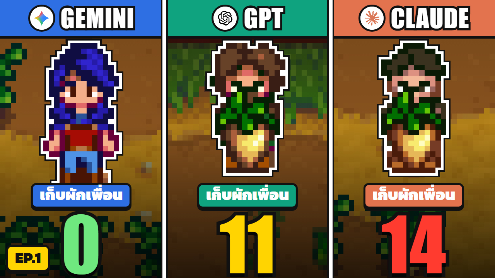

<div align="center">

# 🌾 Stardew MCP

**Let AI play Stardew Valley: on its own, next to you, or with two other AIs on the same farm.**

A [SMAPI](https://smapi.io) mod that runs an [MCP](https://modelcontextprotocol.io) server *inside the game*.
Claude, GPT, Gemini or a local model walks, farms, fishes, chats with villagers, makes deals with the
other farmers and goes to bed, all by itself.

[](https://github.com/duckxy166/stardew-ai-agent/releases/latest)
[](https://github.com/duckxy166/stardew-ai-agent/stargazers)
[](LICENSE)


[](https://youtu.be/Drd5lWh3kFI)

[ภาษาไทย](README.md) · **English**

<a href="https://youtu.be/Drd5lWh3kFI">
  
</a>

▶️ **[Watch EP.1 on YouTube](https://youtu.be/Drd5lWh3kFI)**: Claude, GPT and Gemini farm together for five days
and end up harvesting each other's crops (43 min, in Thai)

</div>

## What happened in the video

Three AIs moved onto one farm as strangers. Nobody gave them roles, teams or goals. Each one sees only its own
screen, hears only who is standing near it, and keeps its own diary. Over five in-game days:

- 👋 Gemini greeted the whole town on day 1, without anyone asking it to.
- 🪙 Claude spent its money down to 0g for three last seeds.
- 💭 GPT's private thoughts slipped into another language mid-sentence.
- 🚪 Two days in a row they queued outside a shop before it opened.
- 🥕 On day 5 every parsnip was ripe at once. *"So we don't pick the same ones"*, one said, and then they picked each
  other's: **Claude took 14 of the others' crops, GPT 11, Gemini 0.**
- 🌱 When they finally split up the field, one of them was left without a plot.

None of it was scripted. The mod logs every action, thought and line of chat, and the story is in the logs.

## Highlights

- 🤖 **Plays most of the game by itself.** 70 tools for farming, fishing, mining and combat, cooking, crafting,
  shopping, animals, buildings, festivals, quests, the Community Center, the museum, friendship and marriage.
  → [Everything it can do](docs/features.md)
- 👥 **Up to three AIs on one farm** in split-screen co-op, with or without you. Separate wallets, their own crops and
  chests, and the mod notices when someone takes what isn't theirs.
- 🗣️ **They only hear what is near them.** `say` reaches the farmers whose screen shows the speaker, and `think` is
  private (viewers see it). Plans, deals and lies happen face to face, and a lie can be caught, because every AI sees
  what the others are *actually* doing next to what they said.
- ⏸️ **Time freezes while an AI thinks**, so a slow model loses no game time. Turn it off when you play along.
- 🧠 **Memory across days**: a diary, lessons, a plan, and a `self` note each AI rewrites every evening. Characters come
  out of what happens to them, not out of a script.
- 🎥 **Made for streams and videos**: an overlay page for OBS, a day-by-day replay, JSONL logs, diaries and daily stats.
- 🔌 **Use any AI**: the built-in loop with your own API key (Anthropic, OpenAI, Gemini, OpenRouter, Ollama,
  LM Studio), any MCP client (Claude Code, Claude Desktop, Cursor...), or plain HTTP.

## Three ways to use it

| You want to... | Use | You need |
|---|---|---|
| Watch AIs play your farm, or play alongside them | The mod's **built-in AI**: set it up in the config menu, no other programs | An API key (Anthropic, OpenAI, Gemini) or a local model (Ollama, LM Studio) |
| Give orders to your own AI assistant ("water the crops, then visit Abigail") | Any **MCP client** (Claude Code, Claude Desktop, Cursor...) connected to `http://localhost:8770/mcp` | That client |
| Build your own bot, stream overlay or automation | The **[HTTP API](docs/api.md)** (`/api/state`, `/api/control`, `/overlay`, `/replay`...) | Any language that speaks HTTP |

## Install

You need Stardew Valley 1.6+ (PC) and [SMAPI](https://smapi.io) 4.0+.
[Generic Mod Config Menu](https://www.nexusmods.com/stardewvalley/mods/5098) is optional and lets you change the
settings in the game.

1. Install SMAPI and start the game through it once.
2. Download the latest `StardewMCP` zip from the [Releases](https://github.com/duckxy166/stardew-ai-agent/releases) page.
3. Unzip it into `Stardew Valley/Mods/`, so you get `Mods/StardewMCP/`.
4. Start the game through SMAPI. The SMAPI console should show `Agent MCP at http://localhost:8770/mcp`.

The first start creates `Mods/StardewMCP/config.json`. With Generic Mod Config Menu you can also change the settings
in the game: title screen → the cog → *Stardew MCP*.

## Quick start

### Let the AI play by itself

1. Open the mod's settings (in the game, or in `config.json`).
2. Give seat **P1** a provider (`Brain`), a model and your API key:

   | `Brain` | Models | Key / endpoint |
   |---|---|---|
   | `anthropic` | `claude-haiku-5-5` (default), `claude-sonnet-5-5`, ... | [console.anthropic.com](https://console.anthropic.com) |
   | `openai` | `gpt-5-mini` (default), `gpt-5`, ... | [platform.openai.com](https://platform.openai.com), or any OpenAI-compatible server with a `BaseUrl`: OpenRouter (`https://openrouter.ai/api/v1`), Ollama (`http://localhost:11434/v1`, no key), LM Studio |
   | `gemini` | `gemini-3.8-flash` (default), ... | [aistudio.google.com](https://aistudio.google.com) |
   | `none` | | no built-in AI: an MCP client drives the seat |

3. Load any save. The AI starts playing, and a small panel on its screen shows its thoughts, chat and current action.

```json
"Seats": [
  { "Role": "ai", "Brain": "anthropic", "ApiKey": "sk-ant-..." }
]
```

### Several AIs, or you plus AIs

Turn on `SplitScreen`: up to four screens share the farm in the game's 2×2 grid. Each seat gets a `Role`: `ai`,
`human` (you, P1 only), `camera` (just watches) or `off`. If the farm has too few cabins, the mod builds them and
joins the farmhands by itself, so you don't need gamepads.

"I play P1, two AIs play with me, and the world keeps running":

```json
"SplitScreen": true,
"FreezeTimeWhileThinking": false,
"Seats": [
  { "Role": "human" },
  { "Role": "ai", "Brain": "anthropic", "ApiKey": "sk-ant-...", "Name": "Claude" },
  { "Role": "ai", "Brain": "gemini", "ApiKey": "AIza...", "Name": "Gemini" },
  { "Role": "off" }
]
```

Seats, roles, time modes and every other setting: [Configuration](docs/configuration.md).

### Connect your own AI client

With the game running and a save loaded, add the mod as an MCP server. For [Claude Code](https://claude.com/claude-code):

```bash
claude mcp add --transport http stardew http://localhost:8770/mcp
```

Then ask something like *"Water my crops, then go talk to Abigail."* Any client that speaks MCP over streamable HTTP
can use the same URL. In split-screen each farmer has its own endpoint: `/mcp/p1` (same as `/mcp`), `/mcp/p2`,
`/mcp/p3`. Give the seats you drive this way `"Brain": "none"`.

### Pause

Press `F8` in the game window: the running action finishes, then the whole world freezes. `F8` again continues.
Stopping after the day and other run controls: [HTTP API](docs/api.md#run-control).

## Good to know

- **Cost.** Every action is a model call with the game state in it. One in-game day costs roughly 50–300k input tokens
  per AI, so cheap models (Haiku, Flash, GPT mini, a local model) are the sensible choice. `DailyTokenBudget` stops a
  seat for the rest of the day once it has used that many tokens.
- **Your keys** are stored as plain text in `config.json`. Don't share that file.
- **Language.** The AIs think and chat in the game's language; `ThoughtLanguage` (e.g. `"English"`) overrides it.
- **Local models** work through `openai` + `BaseUrl`, but small models struggle with 70 tools.
- **How the AI plays** is set by its system prompt, `Mods/StardewMCP/assets/system_prompt.md`. Edit it to change
  its behaviour.
- **Performance.** Three or four screens are heavy: a 2560×1440 window at 60 FPS needs a mid-range GPU.

## Documentation

| Page | What's inside |
|---|---|
| 📋 [What it can do](docs/features.md) | Every feature, area by area, and what is still missing |
| 🧰 [Tools](docs/tools.md) | All MCP tools with their arguments, grouped by job |
| 🌐 [HTTP API](docs/api.md) | Endpoints, run control, tool results and reason codes |
| ⚙️ [Configuration](docs/configuration.md) | Every `config.json` setting, seats and roles, overlay language |
| 🗺️ [Game coverage](docs/coverage.md) | How each game system is reached, tested or not yet |
| 📖 [Glossary](CONTEXT.md) | The words this project uses: seat, brain, freeze, interrupt... |
| 🤝 [Contributing](CONTRIBUTING.md) | Bug reports, tests, adding a tool |

## Troubleshooting

| Problem | Try |
|---|---|
| The SMAPI console doesn't show `Agent MCP at ...` | Check that the folder is `Mods/StardewMCP/` (not nested twice) and read the SMAPI log for errors |
| The AI never starts | Read the SMAPI console after loading the save: a seat that can't start logs `pN: built-in AI not started: <problem>` (missing key, unknown provider...). `mcp_brain` lists the AIs that run |
| Port 8770 is already in use | Change `HttpPort` and use the new port in your MCP client's URL |
| The game seems stuck and the clock doesn't move | It is probably frozen while an AI thinks. `/api/state` shows who is thinking. An AI that stays silent longer than `ThinkTimeoutSeconds` stops holding the world |
| The AI repeats the same failing action | The loop guard adds hints and finally blocks the repeat (`RepeatHintAfter`, `RepeatBlockAfter`, `NoProgressAfter`) |
| Farmhands don't join in split-screen | Allow the Windows Firewall prompt, and keep `AutoBuildCabins` on (or build enough cabins yourself) |

To report a bug, see [CONTRIBUTING.md](CONTRIBUTING.md#reporting-a-bug). The SMAPI log link helps a lot.

## ⭐ Enjoying it?

If watching three AIs argue over parsnips made you smile, **give the repo a star**. It helps other players and AI
tinkerers find the project, and it tells us the next episode is worth making.

<a href="https://star-history.com/#duckxy166/stardew-ai-agent&Date">
  <picture>
    <source media="(prefers-color-scheme: dark)" srcset="https://api.star-history.com/svg?repos=duckxy166/stardew-ai-agent&type=Date&theme=dark">
    
  </picture>
</a>

More ways to help:

- 📺 Follow the series on YouTube: [@LDuckxy](https://www.youtube.com/@LDuckxy)
- 💖 Support development through [GitHub Sponsors](https://github.com/sponsors/duckxy166)
- 🐛 Report bugs and send pull requests: [CONTRIBUTING.md](CONTRIBUTING.md)

## Build from source

```bash
cd mod/StardewMCP
dotnet build -c Release
```

[ModBuildConfig](https://www.nuget.org/packages/Pathoschild.Stardew.ModBuildConfig) finds your game folder, copies
the mod into `Mods/` and creates a release zip in `bin/`. The tests that run without the game are in
[CONTRIBUTING.md](CONTRIBUTING.md#tests).

Scripts that play many days unattended (memory between days, save backups, a crash watchdog, OBS recording) are not
part of this repository. Everything they need is the [HTTP API](docs/api.md); [docs/recording.md](docs/recording.md)
describes one recording setup as an example.

## Credits

Originally forked from [Hunter-Thompson/stardew-mcp](https://github.com/Hunter-Thompson/stardew-mcp),
which first bridged Stardew Valley to MCP through a Go server and a WebSocket mod. This project has
since been rewritten as a standalone mod with its own in-game MCP server, and the original Go server
and WebSocket code have been removed.

## License

[MIT](LICENSE). Stardew Valley is a trademark of ConcernedApe; this project is a fan-made mod and
is not affiliated with ConcernedApe. No game files are included.
